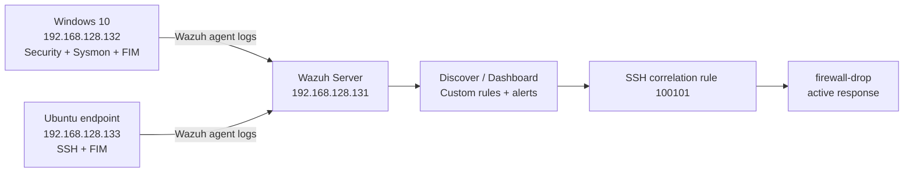

# Wazuh SOC Home Lab — Threat Detection & Automated Incident Response

I built this SOC home lab to practise monitoring Windows and Linux endpoints using **Wazuh**, investigating security events and building my own detection rules. I used VMware virtual machines, an Ubuntu Wazuh server, Windows 10 with Sysmon and an Ubuntu endpoint. I also tested file integrity monitoring and an automated response to repeated SSH login failures.

This lab follows **MyDFIR's Build a SOC Lab with Wazuh** tutorial, adapted to the configuration and testing shown in my own screenshots.

## Project documentation

- **[Step-by-step lab guide](step-by-step-lab-guide.md)** — full setup, agent enrolment, archives, Sysmon, detections, dashboard, file integrity and active response.
- [Investigation report](investigation-report.md) — what I tested, evidence, analyst interpretation and limitations.
- [Lab architecture](architecture.md) — diagram, network, component roles and how the logs move.
- [Screenshots](SCREENSHOT.md) — every screenshot (01–40)

## Lab setup

| Component | Details from my lab |
|---|---|
| Virtualisation | VMware |
| SIEM/XDR | Wazuh |
| Wazuh server | Ubuntu — `192.168.128.131` |
| Windows endpoint | Windows 10 — `192.168.128.132` |
| Linux endpoint | Ubuntu — `192.168.128.133` |
| Windows telemetry | Windows Security events, Sysmon, FIM |
| Linux telemetry | SSH authentication events, FIM |
| Detection rules | Guest account enabled (`100200`), repeated SSH failures (`100101`) |
| Active response | `firewall-drop` on rule `100101` |

These values are from my home lab and could change if I rebuilt it.

## Lab architecture

See [architecture.md](architecture.md) for more detail, including what each component does and how telemetry is collected.

**[SCREENSHOT PLACEHOLDER — 14: Windows and Linux agents connected]**

## What I did

1. Installed an Ubuntu-based Wazuh server and confirmed the dashboard worked.
2. Configured archives so I could inspect additional events in Discover.
3. Added Windows and Linux Wazuh agents.
4. Installed Sysmon on Windows and configured event collection.
5. Created and investigated Windows user-account and group membership events.
6. Generated invalid sign-ins and searched their logs.
7. Built a dashboard showing Windows logon failures, account changes and Linux failed SSH activity.
8. Configured real-time FIM on Windows and Linux and checked a detected file modification.
9. Created a high-severity custom alert for the Windows Guest account being enabled.
10. Created an SSH correlation rule and linked it to Wazuh `firewall-drop` active response.

For configurations, searches and explanations see the [full step-by-step guide](step-by-step-lab-guide.md).

## Detection rules and results

| Detection | Rule or event | Evidence / result |
|---|---|---|
| Windows account activity | 4720, 4722, 4732 etc. | Search results for test account changes |
| Failed Windows logons | 4625 | `fakeuser` found in archive search; dashboard snapshot count 3 |
| Windows file monitoring | Wazuh rule `550` | `C:\CompanyData\payroll.txt` was detected as modified |
| Guest account enabled | Custom rule `100200` | Custom Guest-account alert displayed |
| Repeated SSH failures | Custom rule `100101` | Correlated failure alert displayed |
| Firewall response | `firewall-drop` | Wazuh reported a host-block active-response event |

## Alert validation

I tested my custom rules rather than stopping at configuration. The Guest-account detection produced an alert in Discover. The SSH test generated both the repeated-authentication-failure alert and an active-response event reporting `firewall-drop`.

The screenshots support the Wazuh response being invoked, but I did not capture a seperate connectivity test confirming the exact firewall block duration or packets dropped.

## MITRE ATT&CK

- [T1110 — Brute Force](https://attack.mitre.org/techniques/T1110/) — repeated SSH login failures.
- [T1078 — Valid Accounts](https://attack.mitre.org/techniques/T1078/) — monitoring unexpected Guest account enablement.

These are mappings for simulated lab behaviour, not a claim that a real attacker was present.

## What I learned

This lab helped me get hands-on experiance with collecting logs from two operating systems, investigating events in a SIEM, working with Windows Event IDs, integrating Sysmon and creating custom rules. The biggest learning for me was seeing the full process from triggering activity through to an alert and automated response.

## References

- [Wazuh Documentation](https://documentation.wazuh.com/current/)
- [Wazuh custom rules](https://documentation.wazuh.com/current/user-manual/ruleset/rules/custom.html)
- [Wazuh file integrity monitoring](https://documentation.wazuh.com/current/user-manual/capabilities/file-integrity/index.html)
- [Microsoft Sysmon](https://learn.microsoft.com/en-us/sysinternals/downloads/sysmon)
- [MITRE ATT&CK](https://attack.mitre.org/)

**Author:** Michael Wright | **Project:** Self-directed Blue Team / SOC lab | **Date:** October 2026
