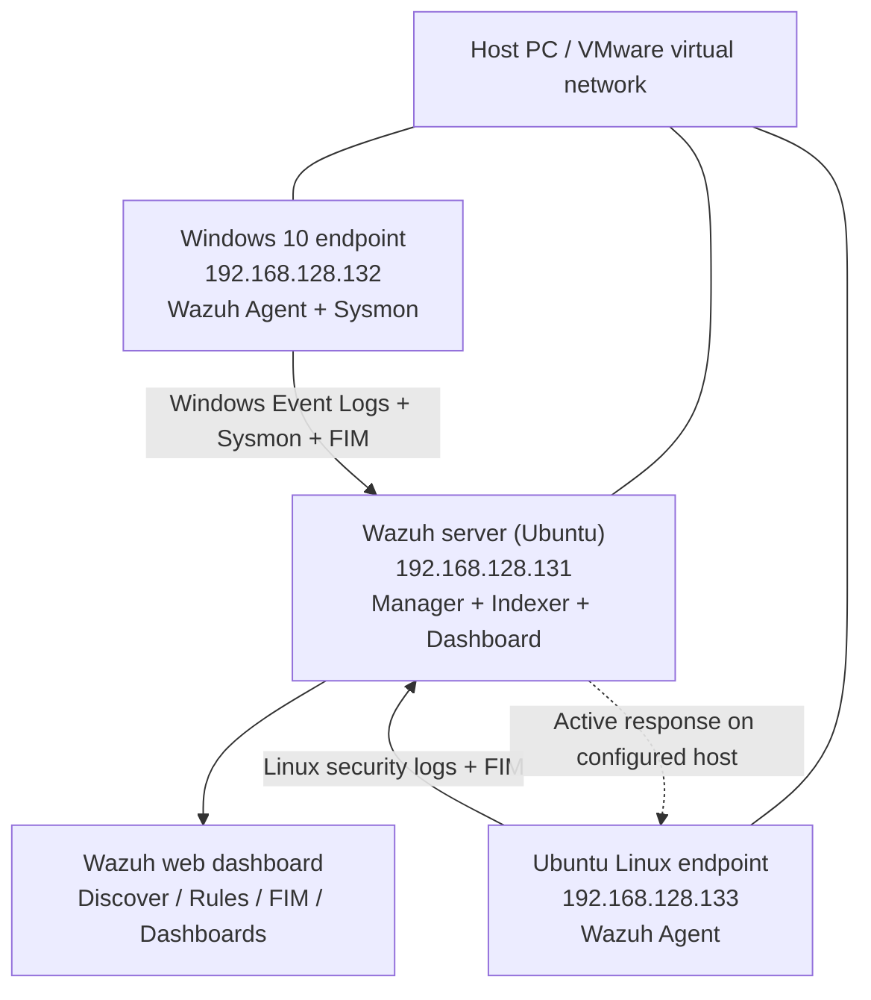

# Wazuh SOC Home Lab — Threat Detection, File Integrity Monitoring & Automated Response

**Project type:** Self-directed cybersecurity / Blue Team / SOC home lab  
**Date:** October 2026  
**Environment:** VMware virtual machines, Wazuh SIEM/XDR, Ubuntu Linux, Windows 10, Sysmon  
**Tutorial reference:** [MyDFIR — Build a SOC Lab with Wazuh](https://www.youtube.com/watch?v=duEibRGYMHo) (followed and adapted to my lab)

## 1. Project overview

I built a small Security Operations Centre (SOC) home lab using Wazuh to collect and investigate security events from Windows and Linux endpoints. My main goal was to get more hands-on practise with log collection, event searching, custom detection rules, dashboards, file integrity monitoring (FIM), and basic automated incident response.

I followed the **Build a SOC Lab with Wazuh** series by MyDFIR, then used my own virtual machines, created test activity and took screenshots to document the results. This README focuses on what I actually configured and tested rather than treating the tutorial as work I developed from scratch.

### What I completed
- Installed and accessed a dedicated Ubuntu-based Wazuh server.
- Connected Windows 10 and Ubuntu endpoints to the manager.
- Configured Wazuh archived event logging for deeper searches.
- Installed Sysmon on Windows and configured Wazuh to collect its event channel.
- Created Windows account-management events and investigated their Event IDs.
- Generated unsuccessful Windows logons and SSH logon attempts.
- Built a Wazuh dashboard to visualise selected security activity.
- Monitored test directories and detected a modification to a monitored file.
- Added custom Wazuh rules for a Windows Guest account event and repeated SSH authentication failures.
- Configured Wazuh active response and observed a firewall-drop response after SSH login failures.

> **Scope:** This was a controlled home lab. All test activity was carried out against my own virtual machines. The screenshots demonstrate detection and response inside the lab, not production SOC coverage.

## 2. Lab architecture



| Component | Lab IP | Purpose |
|---|---|---|
| Wazuh server | `192.168.128.131` | Central security-event collection, correlation, indexing and dashboard |
| Windows 10 VM | `192.168.128.132` | Windows event, account-management, Sysmon, login and FIM testing |
| Ubuntu Linux VM | `192.168.128.133` | Linux log collection, FIM and SSH authentication testing |

Wazuh agents forward telemetry from the endpoints to the central Wazuh deployment. On the Windows system, Sysmon gives extra host activity visibility alongside regular Windows event logs. On the Linux system, SSH and file events supplied useful detection data. The server processes events into searchable records and alerts.

**Evidence:** [01 — Ubuntu VM](#screenshot-evidence-index), [02 — SSH access](#screenshot-evidence-index), [03 — Wazuh installation](#screenshot-evidence-index), [04 — initial dashboard](#screenshot-evidence-index), [12–15 — agent connections](#screenshot-evidence-index).

**[SCREENSHOT PLACEHOLDER — 04: First successful login to the Wazuh dashboard]**  
**[SCREENSHOT PLACEHOLDER — 14: Wazuh showing Windows and Linux agents connected]**

## 3. Wazuh server setup and archived logging

First I configured the Wazuh server on Ubuntu and connected to it using SSH. I then opened the Wazuh web interface to confirm that the installation was working.

By default, Wazuh focuses on events that produce alerts. I also worked through the archive configuration so I could search additional raw activity without needing every single event to match an alert rule. This was usefull when investigating Windows account events and logon activity.

The Wazuh documentation describes the manager options `logall` and `logall_json`; archived JSON events can be indexed and searched in Discover. **The screenshots document my archive setup and use of the archive index; exact option values should be checked against the saved configuration if reproducing this lab.**

Example manager-side configuration (reference, not a verbatim copy of my complete file):

```xml
<global>
  <logall>yes</logall>
  <logall_json>yes</logall_json>
</global>
```

After changing manager configuration, restart the relevant service and verify events appear. Archiving more telemetry uses additional storage, so this needs retention controls in a real environment.

**Evidence:** 05–11 (archive configuration), 22–28 (searching archived Windows events).

**[SCREENSHOT PLACEHOLDER — 05–11: Archive configuration, file edits and verification]**

## 4. Connecting the Windows and Linux agents

Next I installed and connected a Wazuh agent on my Windows 10 virtual machine and connected the Ubuntu endpoint. This let me monitor two different operating systems within the same dashboard.

I used the Wazuh agent views to check connectivity and identify the endpoints before moving onto security testing.

**Result:** My screenshots show both Windows and Linux agent connections in Wazuh.

**[SCREENSHOT PLACEHOLDER — 12: Windows agent setup]**  
**[SCREENSHOT PLACEHOLDER — 13–15: Windows and Linux agents visible in Wazuh]**

## 5. Windows Sysmon integration

I downloaded Microsoft Sysmon for the Windows endpoint and updated the Windows Wazuh agent's `ossec.conf` configuration to include the Sysmon Operational event channel. This is useful because the normal Windows Security logs and Sysmon events provide different kinds of host information.

Example of the event-channel collection block:

```xml
<localfile>
  <location>Microsoft-Windows-Sysmon/Operational</location>
  <log_format>eventchannel</log_format>
</localfile>
```

After the agent configuration was applied, I checked Wazuh to verify Sysmon-related logs were arriving.

**Result:** Sysmon telemetry appeared in Wazuh and I was able to inspect the expanded event information.

**[SCREENSHOT PLACEHOLDER — 16: Sysmon download]**  
**[SCREENSHOT PLACEHOLDER — 17: Agent ossec.conf changes]**  
**[SCREENSHOT PLACEHOLDER — 18–20: Sysmon events visible in Wazuh]**

## 6. Windows account activity investigation

I generated test Windows account activity involving creating, changing and deleting users, then looked for the results in Discover. I also built seperate searches for account creation, local security-group membership changes and logon events.

Some important Windows Security Event IDs used for this kind of analysis are:

| Event ID | Meaning | Why it matters |
|---|---|---|
| 4720 | User account created | Identifies new local or domain accounts |
| 4722 | User account enabled | May indicate an account was re-enabled |
| 4723 | Attempt to change account password | Helps investigate password changes |
| 4724 | Attempt to reset an account password | Useful for privileged account changes |
| 4726 | User account deleted | Tracks removal of accounts |
| 4732 | Member added to a security-enabled local group | Useful for monitoring changes in access |
| 4733 | Member removed from a security-enabled local group | Tracks access removal |
| 4738 | User account changed | Helps identify unexpected account modification |
| 4624 | Successful logon | Useful authentication context |
| 4625 | Failed logon | Possible credential guessing when repeated |

Event IDs provide leads, not proof of malicious activity by themselves. I checked the time, target username, host and other event fields to understand each result.

**[SCREENSHOT PLACEHOLDER — 21: Generating Windows account changes]**  
**[SCREENSHOT PLACEHOLDER — 22–23: Account event results and expanded event detail]**  
**[SCREENSHOT PLACEHOLDER — 24–26: Saved-style searches for account creation, group changes and logons]**

### Failed Windows logon test

I also made deliberate invalid sign-in attempts against my test Windows environment and searched for the username `fakeuser`. In the screenshots I can see multiple authentication-related results after the testing.

**Result:** The archive search returned events matching `fakeuser`. The dashboard also contains a failed Windows logon metric.

**[SCREENSHOT PLACEHOLDER — 27: Producing invalid Windows logons]**  
**[SCREENSHOT PLACEHOLDER — 28: Searching for fakeuser and reviewing the returned events]**

## 7. SOC monitoring dashboard

To make the event data easier to review, I created a custom dashboard in Wazuh/OpenSearch Dashboards. It includes a Windows failed-logon metric, a time-series graph for account-management events and a table of Linux failed SSH authentications.

This brought multiple investigations into one place and helped me see authentication and account activity without repeating each search individually.

**Result shown in my screenshots:** The dashboard displays a failed-Windows-logon metric of **3** for the selected time range, a Windows account-change timeline and Linux SSH-related entries. That number is a captured snapshot, not a fixed lab total.

**[SCREENSHOT PLACEHOLDER — 29: Starting the dashboard visualisations]**  
**[SCREENSHOT PLACEHOLDER — 30: Completed MYDFIR dashboard]**

## 8. File integrity monitoring (FIM)

I enabled real-time file monitoring in the agent configurations so Wazuh could identify changes to selected test directories.

### Windows FIM

I configured the Windows agent to monitor a test company-data directory:

```xml
<directories realtime="yes">C:\CompanyData</directories>
```

I then edited a file and looked for the change in Wazuh. The FIM event view shows:

- **Agent:** `MYDIF_WINDOWS` (name as displayed in the lab screenshot)
- **File:** `c:\companydata\payroll.txt`
- **Event:** `modified`
- **Rule ID:** `550`
- **Description:** `Integrity checksum changed.`

This demonstrated that the system could identify an alteration to a watched file, rather than just collect login events.

**[SCREENSHOT PLACEHOLDER — 31: Windows FIM configuration for C:\CompanyData]**  
**[SCREENSHOT PLACEHOLDER — 32: Wazuh showing payroll.txt modified]**

### Linux FIM

I also configured Linux directories for integrity monitoring, including a test path under `/opt/soc-lab`. The configuration screenshot includes real-time monitoring settings. I generated test file changes and used Wazuh to investigate the resulting events.

**[SCREENSHOT PLACEHOLDER — 33: Linux syscheck configuration]**  
**[SCREENSHOT PLACEHOLDER — 34: Triggered Linux file event and Wazuh view]**

> FIM tells an analyst that a monitored file changed. It does **not** automatically establish that the change was malicious. Further investigation would be required.

## 9. Custom Wazuh detection rules

Wazuh includes built-in rules, but I wanted to try making my own detections for events I cared about. I edited `local_rules.xml` through the Wazuh Rules interface.

### Rule 100200 — Windows Guest account enabled

I added a custom rule for Windows Security Event ID **4722** when the target account name was **Guest**. This is worth investigating because a newly enabled Guest account can increase exposure if it was not authorised.

The configuration shown in my screenshot uses:

- Custom rule ID: `100200`
- Severity: `12`
- Parent rule: `60103`
- Event ID: `4722`
- Target username: `Guest`
- MITRE mapping entered: `T1078` (Valid Accounts)

For readability, the core of the screenshot rule is:

```xml
<group name="windows,windows_security,account_changed,adduser,">
  <rule id="100200" level="12">
    <if_sid>60103</if_sid>
    <field name="win.system.eventID">^4722$</field>
    <field name="win.eventdata.targetUserName">^Guest$</field>
    <description>MYDFIR-Steven Windows Guest account was enabled.</description>
    <mitre><id>T1078</id></mitre>
    <group>windows_account_management,account_enabled,guest_account,</group>
  </rule>
</group>
```

The custom alert description follows the tutorial naming visible in my screenshot. It isn't the Windows hostname.

**Result:** The Discover screenshot includes the new custom Guest-account alert as well as a related account-enabled event. This shows the custom rule was firing in my lab.

**[SCREENSHOT PLACEHOLDER — 35: Guest-account custom detection rule]**  
**[SCREENSHOT PLACEHOLDER — 36: Custom Guest-account alert in Discover]**

### Rule 100101 — Multiple SSH login failures

I then created a seperate SSH correlation rule for repeated failed login attempts against the Linux side of the lab.

The rule in the screenshot is configured with:
- ID `100101`
- Level `10`
- `frequency="3"`
- `timeframe="120"`
- `if_matched_sid>5760</if_matched_sid>`
- `same_source_ip` to correlate attempts from the same originating IP
- MITRE `T1110` (Brute Force)

This checks for repeated failure activity within a short time window. A few failures could be a user mistake, but a pattern from the same source deserves investigation.

```xml
<group name="local,syslog,sshd,authentication_failed,">
  <rule id="100101" level="10" frequency="3" timeframe="120">
    <if_matched_sid>5760</if_matched_sid>
    <same_source_ip />
    <description>Multiple SSH login failures observed from the same source IP</description>
    <mitre><id>T1110</id></mitre>
    <group>authentication_failed,ssh_bruteforce,credential_access,</group>
  </rule>
</group>
```

**Result:** My Discover screen includes the rule description **Multiple SSH login failures observed from the same source IP** and individual SSH authentication failures.

**[SCREENSHOT PLACEHOLDER — 37: Rule 100101 in local_rules.xml]**

## 10. Automated incident response — firewall-drop

I configured an active-response block tied to rule `100101`, using Wazuh's `firewall-drop` command. I restarted the Wazuh manager and checked the list of active response commands before testing it.

The active response section in the screenshot includes:

```xml
<active-response>
  <disabled>no</disabled>
  <command>firewall-drop</command>
  <location>local</location>
  <rules_id>100101</rules_id>
</active-response>
```

I generated multiple unsuccessful SSH login attempts from my lab system, and checked the Wazuh alerts. The final screenshot shows the sequence of authentication failures, the custom multiple-failure alert, and **Host Blocked by firewall-drop Active Response**.

### Test sequence
1. Attempted SSH authentication with invalid credentials/users from the lab.
2. Wazuh recorded SSH login failures.
3. Custom rule `100101` generated a multiple-failures alert.
4. An active-response alert reported `firewall-drop` execution.

**Observed result:** The Wazuh alerts show that the automated response was invoked. I did not capture a separate packet-level connectivity test or firewall ruleset output proving the block duration, so I am careful not to claim that as independently verified.

**[SCREENSHOT PLACEHOLDER — 38: Active-response configuration]**  
**[SCREENSHOT PLACEHOLDER — 39: firewall-drop command available]**  
**[SCREENSHOT PLACEHOLDER — 40: SSH failures, custom detection and firewall-drop active-response alert]**

> **Safety:** Active response can disconnect legitimate clients or administrators. Test against non-essential systems and define exclusions, expiry and recovery procedures before deploying similar rules outside a lab.

## 11. Results and evidence

| Test | Outcome in screenshots | Evidence |
|---|---|---|
| Wazuh deployment | Server accessible and web dashboard running | 01–04 |
| Archive configuration | Archive setup and subsequent archived-event searches | 05–11, 22–28 |
| Agent enrolment | Windows and Linux endpoints visible in Wazuh | 12–15 |
| Sysmon collection | Sysmon events visible and expandable | 16–20 |
| Windows account monitoring | Account-event searches returned telemetry | 21–26 |
| Invalid Windows login tests | `fakeuser` events visible in Discover | 27–28 |
| SOC dashboard | Failed logon, account-change and SSH views created | 29–30 |
| Windows file integrity | Modification to `payroll.txt` reported | 31–32 |
| Linux file integrity | Configured test directories and generated activity | 33–34 |
| Guest-account custom rule | Custom alert appears in Wazuh | 35–36 |
| SSH brute-force detection | Correlation rule and matching alert visible | 37, 40 |
| Automated response | `firewall-drop` active-response alert reported | 38–40 |

## 12. What I learned

The most valuable part of this project was working through the entire monitoring process: **generating an event → collecting it → searching the logs → writing detection logic → validating an alert → observing a response**.

I got practical experience working with Windows Security Event IDs, Linux SSH authentication records, Wazuh rules, Sysmon telemetry, FIM and the Wazuh dashboard. It was also helpful to see how a high-level detection can be traced back to specific log events.

Some challenges were getting the agents and logs to show the right data, finding fields that matched the search queries, and setting up custom rules so they would trigger on the intended activity. Troubleshooting these issues helped me better understand where events come from and how Wazuh handles them.

## 13. Limitations and next improvements

This is a home lab rather than a fully deployed enterprise SIEM. I have not independently measured alert false-positive rates, ingestion latency, or firewall block duration. The screenshots also do not show independent packet-level verification of a blocked SSH connection.

Possible next steps:
- Export and sanitise exact deployed XML settings and custom rules so others can reproduce them.
- Add additional simulated incident scenarios and document investigation timelines.
- Tune correlation thresholds using normal background activity to reduce false positives.
- Confirm firewall blocks with host firewall state and a repeat connection test, while recording when access is restored.
- Record the Wazuh/Sysmon versions, platform resource requirements and agent enrolment steps.
- Add a short demonstration video of the detection and response workflow.

## 14. Screenshot evidence index

**How to finish the README:** Create a folder named `screenshots/` in this repository. Upload each of your original screenshots, preferably renamed to `01.png`, `02.png`, … `40.png`. Replace each **[SCREENSHOT PLACEHOLDER]** line above with Markdown such as ``. This avoids broken image links until the files are uploaded.

| # | Suggested name | What it shows |
|---|---|---|
| 01 | `01.png` | Ubuntu VM installation |
| 02 | `02.png` | SSH to Wazuh server |
| 03 | `03.png` | Wazuh download/install |
| 04 | `04.png` | First Wazuh dashboard login |
| 05 | `05.png` | Archive configuration part 1 |
| 06 | `06.png` | Archive configuration part 2 |
| 07 | `07.png` | Archive configuration part 3 |
| 08 | `08.png` | Archive configuration part 4 |
| 09 | `09.png` | Archive configuration part 5 |
| 10 | `10.png` | Archive configuration part 6 |
| 11 | `11.png` | Archive configuration part 7 |
| 12 | `12.png` | Windows agent connection |
| 13 | `13.png` | Windows agent visible |
| 14 | `14.png` | Linux and Windows agents visible |
| 15 | `15.png` | Agent connection details |
| 16 | `16.png` | Sysmon downloaded |
| 17 | `17.png` | Sysmon event-channel configuration |
| 18 | `18.png` | Sysmon events arriving |
| 19 | `19.png` | Expanded Sysmon result |
| 20 | `20.png` | Additional Sysmon/agent monitoring view |
| 21 | `21.png` | Creating Windows account activity |
| 22 | `22.png` | Account events in Wazuh |
| 23 | `23.png` | Expanded account-event details |
| 24 | `24.png` | Search for new user creation |
| 25 | `25.png` | Search for group membership changes |
| 26 | `26.png` | Search for logon events |
| 27 | `27.png` | Invalid SSH/logon traffic generated |
| 28 | `28.png` | `fakeuser` search results |
| 29 | `29.png` | Dashboard visualisation setup |
| 30 | `30.png` | Finished SOC dashboard |
| 31 | `31.png` | Windows file monitor settings |
| 32 | `32.png` | Windows payroll file modification alert |
| 33 | `33.png` | Linux FIM settings |
| 34 | `34.png` | Linux FIM test/result |
| 35 | `35.png` | Guest account detection rule |
| 36 | `36.png` | Guest-account detection fired |
| 37 | `37.png` | SSH repeated-failure custom rule |
| 38 | `38.png` | SSH active-response configuration |
| 39 | `39.png` | firewall-drop available response |
| 40 | `40.png` | SSH failures, detection and response |

## 15. References

- [MyDFIR — Build a SOC Lab with Wazuh](https://www.youtube.com/watch?v=duEibRGYMHo)
- [Wazuh documentation — Event logging and archives](https://documentation.wazuh.com/current/user-manual/manager/event-logging.html)
- [Wazuh documentation — Windows event-channel log collection](https://documentation.wazuh.com/current/user-manual/reference/ossec-conf/localfile.html)
- [Wazuh documentation — Custom rules](https://documentation.wazuh.com/current/user-manual/ruleset/rules/custom.html)
- [Wazuh documentation — Rules syntax](https://documentation.wazuh.com/current/user-manual/ruleset/ruleset-xml-syntax/rules.html)
- [Wazuh documentation — File integrity monitoring](https://documentation.wazuh.com/current/user-manual/capabilities/file-integrity/index.html)
- [Microsoft Sysinternals — Sysmon](https://learn.microsoft.com/en-us/sysinternals/downloads/sysmon)

---

**Project author:** Michael Wright  
**Purpose:** Practical cybersecurity learning, SOC analyst skills and technical portfolio evidence.
