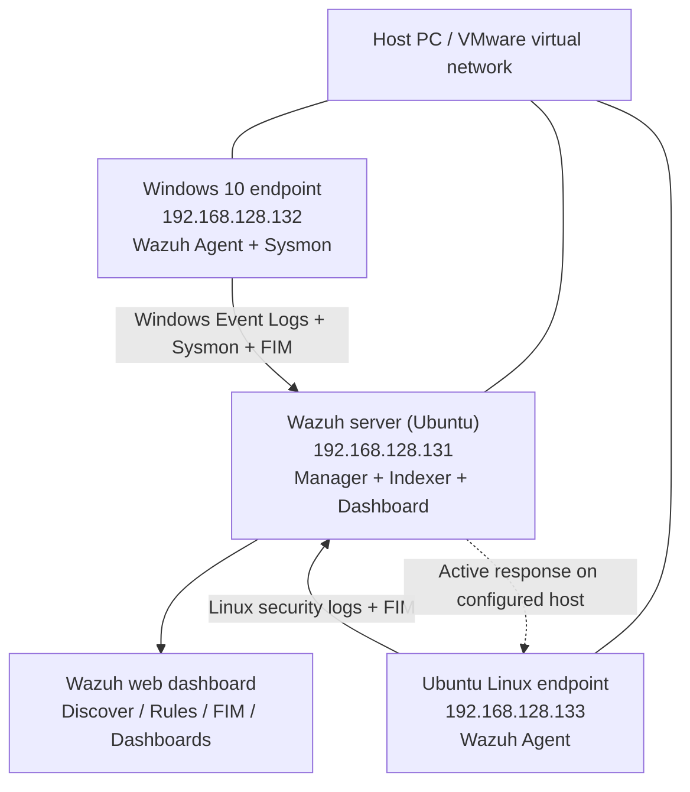

# Wazuh SOC Lab Architecture

[Back to README](README.md) | [Step-by-step guide](step-by-step-lab-guide.md)

## Overview

I used three virtual machines on a VMware lab network to bring Windows and Linux events into a central Wazuh server. Windows Security events, Windows Sysmon telemetry and file integrity changes could be investigated in Wazuh alongside SSH-related Linux activity.

## 2. Lab architecture

| Component | Lab IP | Purpose |
|---|---|---|
| Wazuh server | `192.168.128.131` | Central security-event collection, correlation, indexing and dashboard |
| Windows 10 VM | `192.168.128.132` | Windows event, account-management, Sysmon, login and FIM testing |
| Ubuntu Linux VM | `192.168.128.133` | Linux log collection, FIM and SSH authentication testing |

Wazuh agents forward telemetry from the endpoints to the central Wazuh deployment. On the Windows system, Sysmon gives extra host activity visibility alongside regular Windows event logs. On the Linux system, SSH and file events supplied useful detection data. The server processes events into searchable records and alerts.

**Evidence:** [01 — Ubuntu VM](#screenshot-evidence-index), [02 — SSH access](#screenshot-evidence-index), [03 — Wazuh installation](#screenshot-evidence-index), [04 — initial dashboard](#screenshot-evidence-index), [12–15 — agent connections](#screenshot-evidence-index).

**[SCREENSHOT PLACEHOLDER — 04: First successful login to the Wazuh dashboard]**  
**[SCREENSHOT PLACEHOLDER — 14: Wazuh showing Windows and Linux agents connected]**

## How events travelled through the lab

1. **Windows VM (192.168.128.132):** Windows Security and Sysmon logs are collected by the agent. It also monitors the test `C:\CompanyData` folder.
2. **Ubuntu VM (192.168.128.133):** The Wazuh agent provides endpoint log and file-monitoring coverage, including Linux security activity.
3. **Wazuh server (192.168.128.131):** Receives events, evaluates rules and makes alerts available to search using the dashboard.
4. **Analyst investigation:** I used Discover for event fields and queries, the FIM interface for watched files, and dashboards for account activity and failed logons.
5. **Response:** Custom rule `100101` was linked to the `firewall-drop` active response. The alert page captured the resulting response message.

## Network and security notes

These are private lab IPs, not public-facing addresses. Connectivity uses the virtual network. Wazuh normally uses agent communication on TCP 1514 and agent enrolment on TCP 1515, although the screenshots do not prove these specific port settings. Sysmon collects endpoint details locally and Wazuh sends the resulting events to the manager. The SSH tests used port 22.

**Important:** A Wazuh active-response alert confirms that the configured response was invoked. Independent proof that a firewall rule blocked the remote host would require checking the actual firewall state and testing connectivity.

## Architecture screenshots

**[SCREENSHOT PLACEHOLDER — 01: Ubuntu installation]**

**[SCREENSHOT PLACEHOLDER — 02: SSH connection to Wazuh server]**

**[SCREENSHOT PLACEHOLDER — 04: Wazuh dashboard]**

**[SCREENSHOT PLACEHOLDER — 14: Windows and Linux agents]**

See [SCREENSHOT-GUIDE.md](SCREENSHOT-GUIDE.md) for all 40 filenames.
